# 파도콜 PADO CALL — 공항부터 명소까지, 내 언어로 부르면 오는 관광셔틀
## 2026 글로컬 부산관광 트래블톤 출품작
#### Track 4 · 관광 인프라

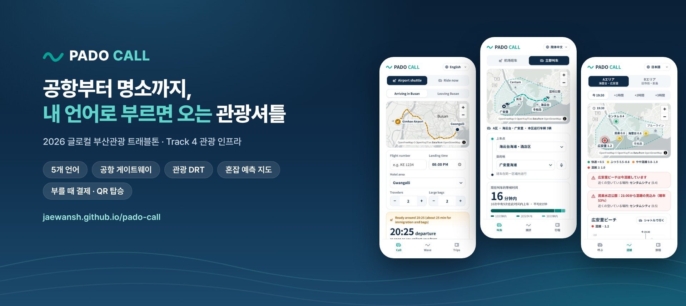

---
### 개발 기간
- 기획: 2026.10 (아이디어 계획서)
- MVP: 2026.10 – 2026.11 (본선 시연용)

---

## 프로젝트 개요

파도콜은 김해공항 게이트웨이(예약 합승)와 두 관광 권역(A 해운대·광안리, B 원도심·영도)을 잇는 **다국어 관광 DRT**입니다.
외국인 개별관광객이 막히는 공항 첫 구간·언어·결제·짐·마지막 구간을 풀고, 혼잡 예측으로 특정 명소 쏠림을 줄이는 것을 목표로 합니다.

**웹 데모 → https://shinshinjae.github.io/pado-call/** — 설치·가입 없이 휴대폰·PC 브라우저에서 바로 실행됩니다 (5개 언어).

| 관광객 앱 | 기사 앱 | 관제 대시보드 | 수리모형 |
|:---:|:---:|:---:|:---:|
| [공항 셔틀·지금 호출](https://shinshinjae.github.io/pado-call/#/call) · [혼잡 지도](https://shinshinjae.github.io/pado-call/#/wave) · [내 여정](https://shinshinjae.github.io/pado-call/#/trips) | [QR 탑승 확인](https://shinshinjae.github.io/pado-call/#/driver) | [관제·예약](https://shinshinjae.github.io/pado-call/#/control) | [모형 설명](https://shinshinjae.github.io/pado-call/#/model) |

---

## 전체 개발 구조

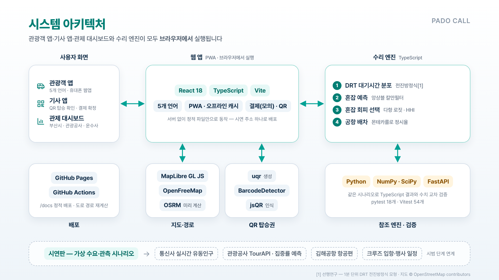

## 시연 영상


---

## 핵심 기능

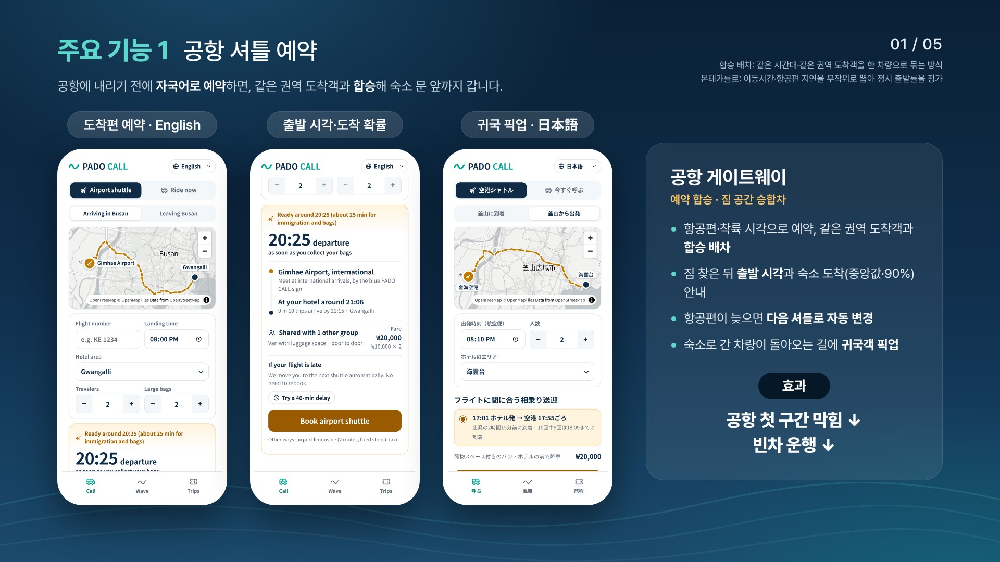
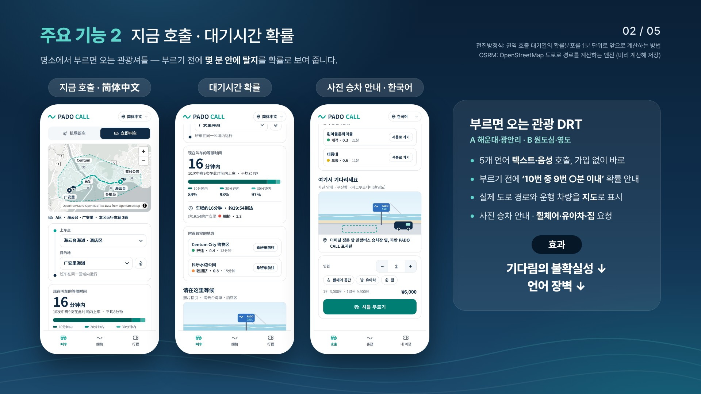
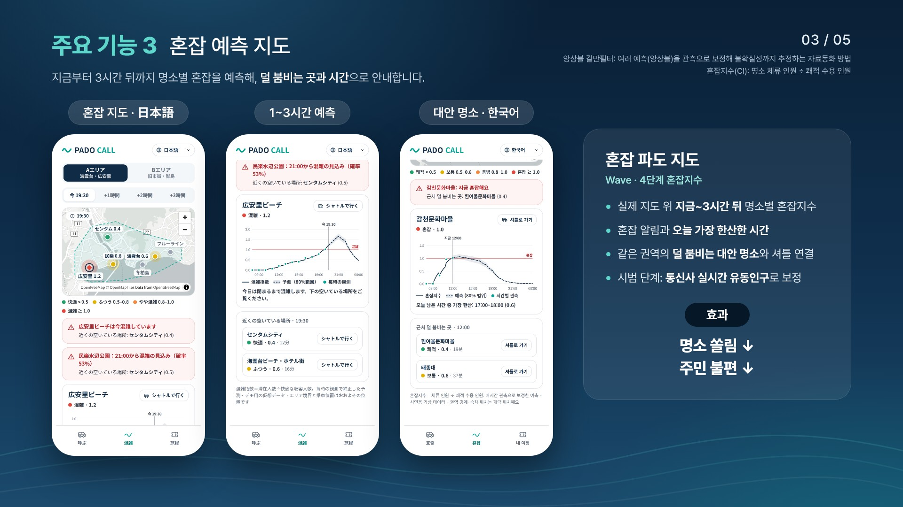
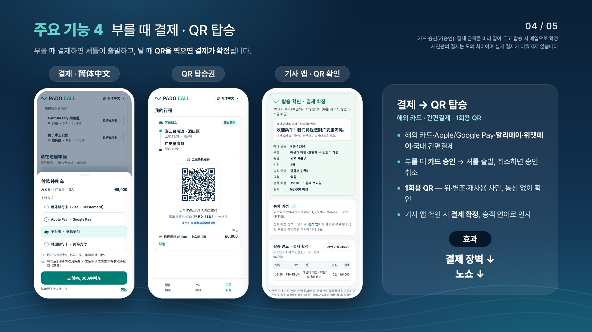
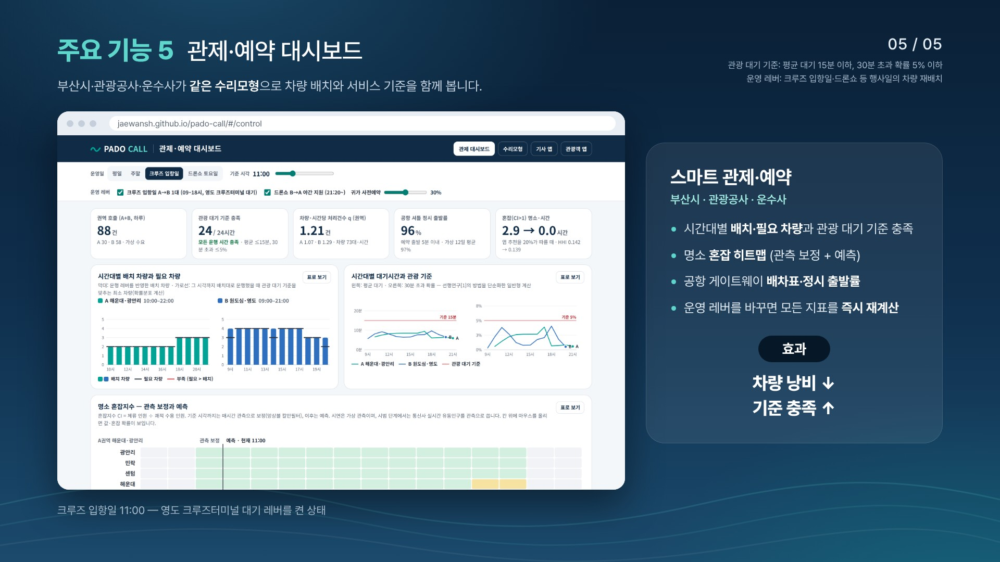

---

## 기술 스택

| 분야 | 기술 |
|------|------|
| Web App | React 18, TypeScript, Vite, PWA |
| Map | MapLibre GL JS, OpenFreeMap (OpenStreetMap), OSRM 도로 경로 (미리 계산) |
| Math Engine | TypeScript — 전진방정식 DRT, 앙상블 칼만필터, 다항 로짓, 몬테카를로 |
| Reference Engine | Python, NumPy, SciPy, FastAPI |
| QR Boarding | uqr, BarcodeDetector, jsQR |
| Test | Vitest 54개, pytest 18개 (TypeScript 결과와 수치 교차 검증), Playwright 화면·QR 스캔 점검 |
| Deploy | GitHub Pages (`/docs`), GitHub Actions |

---

## 주요 구현 코드

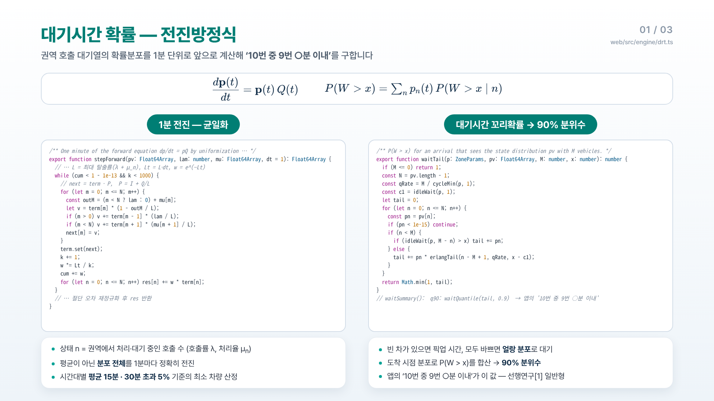
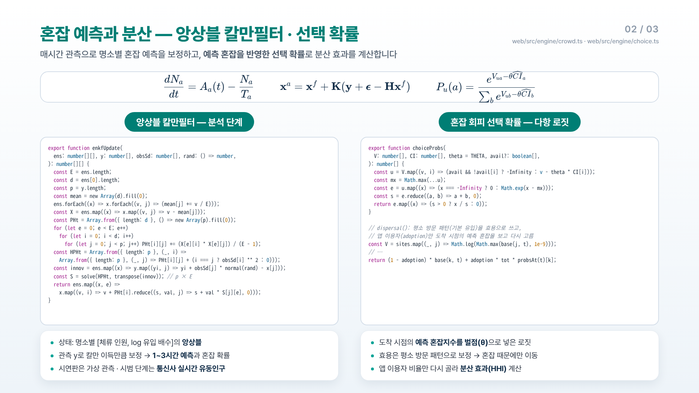
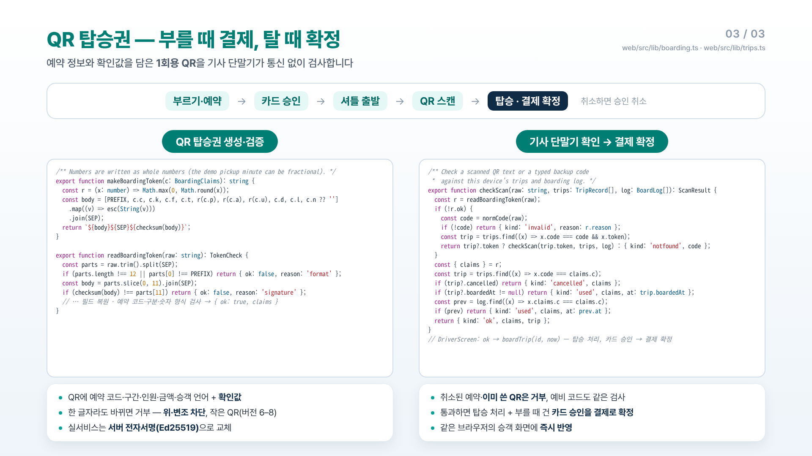

---

## 향후 구현 계획

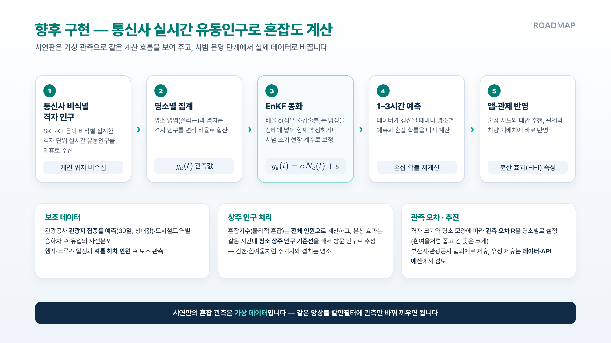

---

## 실행 방법

<details>
<summary><b>웹 앱</b> (Node.js 18 이상)</summary>

```bash
cd web
npm install
npm run dev        # http://localhost:5173 에서 개발 서버
npm test           # 엔진·탑승권 테스트
npm run build      # docs/ 폴더 갱신 (GitHub Pages 배포용)
npm run report     # 시나리오 수치 요약 (권역 q, 필요 차량, 공항 정시율, 혼잡 분산)
npm run routes     # 도로 경로 다시 계산 (인터넷 필요, 명소를 바꾼 뒤 실행)
```

지도 위 이동 경로는 명소 쌍마다 미리 계산해 `web/src/data/routes.json`에 넣어 두므로, 시연 중에는 경로 서버에 접속하지 않습니다. 명소를 추가·변경했다면 GitHub의 Actions → **road routes** → Run workflow로 경로 계산과 빌드를 한 번에 다시 할 수 있습니다. 올리는 방법과 확인 방법은 [GUIDE_GITHUB.md](GUIDE_GITHUB.md)에 정리했습니다.

</details>

<details>
<summary><b>Python 참조 엔진</b> (Python 3.10 이상)</summary>

```bash
cd engine-py
pip install -r requirements.txt
pytest                                  # TypeScript 결과와 교차 검증
uvicorn padocall.api:app --reload       # http://127.0.0.1:8000/docs 에서 API 확인
```

</details>

<details>
<summary><b>폴더 구조</b></summary>

```
pado-call/
├─ docs/            GitHub Pages가 서비스하는 빌드 결과물 (npm run build로 생성)
├─ web/             앱 소스
│  ├─ src/engine/   수리 엔진: drt · crowd · choice · airport (+ 테스트)
│  ├─ src/data/     가상 시나리오: 권역·명소·수요, 도로 경로(routes.json)
│  ├─ src/screens/  Call · Wave · Trips · 기사 앱 · 관제 대시보드 · 수리모형
│  ├─ src/lib/      QR 탑승권(생성·검증) · 여정 상태 · QR 인식
│  └─ scripts/      시나리오 수치 보고서, 참조 엔진용 데이터 내보내기, 도로 경로 계산
├─ engine-py/       Python 참조 엔진, 교차 검증 테스트, FastAPI 서버
├─ .github/workflows/routes.yml  도로 경로 다시 계산 + 빌드 (Actions에서 수동 실행)
├─ image/           README 이미지
└─ GUIDE_GITHUB.md  GitHub 업로드·확인 방법
```

</details>

## 데이터·인용 고지

- 차량 수·요금·수요·관측값은 기획안의 가정치와 시연용 가상 데이터입니다. 지도 위 운행 권역 경계와 승차 위치는 개략 위치입니다.
- 결제는 모의 처리입니다. 시연판 QR의 위·변조 확인값은 데모용 검사값이며, 실서비스에서는 서버 전자서명과 PG사 카드 승인·매입, 노쇼·늦은 취소 수수료(안)를 연동합니다.
- 지도: © OpenStreetMap contributors, © OpenMapTiles, OpenFreeMap.
- 이동 경로: OSRM 자동차 경로(OpenStreetMap 도로 데이터, ODbL)를 미리 계산해 사용합니다. 셔틀 이동 시간은 이 도로 거리를 권역 평균 속도(시속 18 km)로 나눈 값에 승차 1분을 더한 가정치입니다.
- [1] 신재완·김민수(2026), 「부산시 저수요 시내버스 운행의 수요응답형 교통 전환 조건: 1분 단위 정류장 수요 재구성과 Kolmogorov 전진방정식 모형」, 대한교통학회지 투고 원고. 이 저장소에는 [1]의 데이터·보정 결과가 포함되어 있지 않습니다.

---

## 팀원

| 이름 | 역할 |
|---|---|
| | |
| | |
